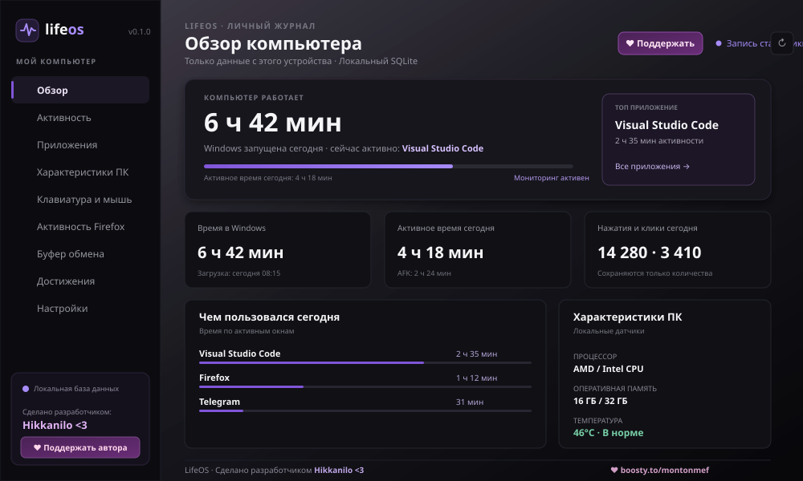
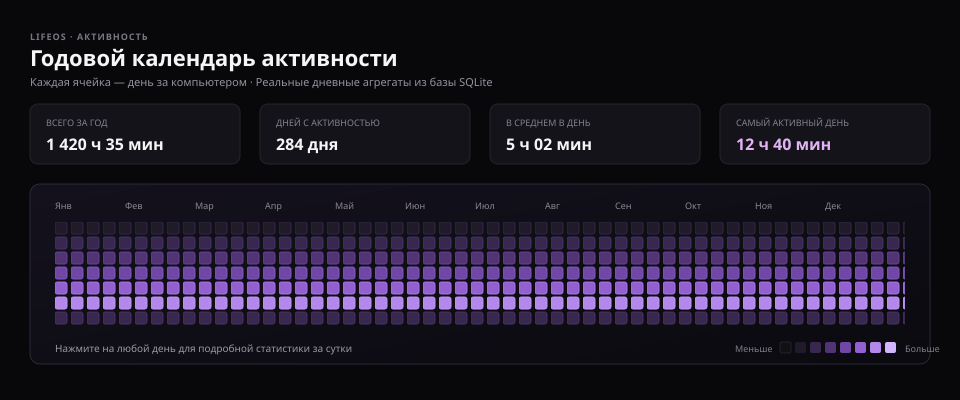

# LifeOS

<div align="center">

[](LICENSE)
[](https://microsoft.com/windows)
[](https://tauri.app/)
[](https://react.dev/)
[](https://github.com/hikkanilo)
[](https://boosty.to/montonmef)

**Локальная панель активности для Windows.**  
LifeOS показывает, как распределяется время за компьютером, ведёт календарь активности и помогает замечать личные привычки. Данные остаются исключительно на вашем устройстве; аккаунт и облачная синхронизация не требуются.

[Возможности](#возможности) • [Установка](#установка-готового-приложения) • [Сборка](#сборка-из-исходников) • [Приватность](#хранение-и-приватность) • [Поддержать проект](#поддержать-проект) • [English](#english)

### Версия 1.1

В обновлении появились четыре темы оформления, выбор темы с сохранением, исправленный журнал выключений Windows и новый установщик `LifeOS_1.1.0_x64-setup.exe`.

Исходный код и релизы: [github.com/hikkanilo/LifeOS](https://github.com/hikkanilo/LifeOS).

</div>

---



## Возможности

- **Учёт времени:** Активное время, бездействие (AFK), клавиатурные нажатия и клики — только агрегированные счётчики количества, текст ввода никогда не записывается.
- **Годовой календарь активности:** Наглядная сетка в духе GitHub contribution graph, построенная на реальных дневных агрегатах из локальной базы данных SQLite.
- **Аналитика приложений:** Подробная статистика использования программ с активным окном, сортировкой, поиском и гибкими периодами (день, неделя, месяц, 30 дней, всё время).
- **Система достижений:** Каталог целей с градацией редкости (Common, Uncommon, Rare, Epic, Legendary), шкалой прогресса и датой получения.
- **Ежедневные отчёты Windows:** Автоматические системные уведомления со сводкой за прошедший день, расписанием, личными рекордами, кликами и полученными наградами.
- **Активность Firefox:** Локальная история заголовков открытых вкладок. URL и содержимое страниц не собираются; приватные вкладки игнорируются.
- **Буфер обмена (текст и изображения):** Локальная история с предпросмотром, поиском и восстановлением. По умолчанию выключено; настраиваемый лимит хранилища и исключения для чувствительных приложений (парольные менеджеры и т.д.).
- **Мониторинг железа:** Сведения о процессоре, видеокарте, оперативной памяти и накопителях. Температуры отображаются только при наличии реального аппаратного датчика.
- **Удобство использования:** Сворачивание в системный трей, опциональный автозапуск вместе с Windows, стильная тёмная тема и поддержка режима пониженного движения (Reduced Motion).

---

## Установка готового приложения

1. Скачайте `LifeOS_*_x64-setup.exe` из раздела **[Releases](https://github.com/hikkanilo/LifeOS/releases)**.
2. Запустите установщик и откройте LifeOS из меню «Пуск» или через ярлык на рабочем столе.
3. Приложению требуется Microsoft Edge WebView2 Runtime (встроен в Windows 10/11 по умолчанию). Для работы установленного приложения Rust или Node.js не требуются.

> [!NOTE]  
> Windows SmartScreen может показать предупреждение для неподписанного релиза с открытым исходным кодом. Вы всегда можете проверить контрольную сумму SHA-256 или собрать проект самостоятельно из исходников.

---

## Сборка из исходников

### Требования:
- Windows 10 / 11 x64
- [Node.js](https://nodejs.org/) 22+ и npm
- [Rust](https://www.rust-lang.org/) stable (1.90 или новее)
- Visual Studio Build Tools с рабочей нагрузкой «Разработка классических приложений на C++»
- Microsoft Edge WebView2 Runtime
- [NSIS](https://nsis.sourceforge.io/) (для сборки `.exe`-установщика)

### Команды для сборки:

```powershell
# Клонирование репозитория
git clone https://github.com/hikkanilo/LifeOS.git
cd LifeOS

# Установка зависимостей
npm ci

# Сборка интерфейса
npm run build

# Проверка Rust-кода
cargo fmt --manifest-path src-tauri/Cargo.toml -- --check
cargo clippy --manifest-path src-tauri/Cargo.toml --all-targets -- -D warnings
cargo test --manifest-path src-tauri/Cargo.toml --all

# Сборка готового инсталлятора
npm run tauri -- build --bundles nsis
```

Готовый установщик появится в директории `src-tauri/target/release/bundle/nsis/`.  
Для запуска в режиме разработки используйте: `npm run tauri -- dev`.

Также доступен автоматизированный скрипт сборки:
```powershell
.\Setup-LifeOS.ps1
```

---

## Хранение и приватность

- **100% Offline & Local-First:** Ваши данные принадлежат только вам и никогда не отправляются на удалённые серверы.
- В установленной версии база SQLite хранится в `%APPDATA%\com.lifeos.desktop\data\lifeos.db`.
- В портативной сборке база размещается в папке `data\` рядом с исполняемым файлом.
- Счётчики клавиатуры и мыши агрегируют исключительно число событий. Буфер клавиатуры не перехватывается, вводимый текст или пароли не читаются.
- История буфера обмена выключена по умолчанию. Сохранение изображений требует отдельного согласия.

---

## Поддержать проект

Если LifeOS вам понравилась и помогает лучше понимать распределение своего времени, вы можете поддержать автора:

[](https://boosty.to/montonmef)

👉 **Boosty:** [https://boosty.to/montonmef](https://boosty.to/montonmef)  
Сделано разработчиком **Hikkanilo <3**

---

## Вклад в проект и лицензия

Мы приветствуем Pull Requests и отчёты об ошибках! Ознакомьтесь с [CONTRIBUTING.md](CONTRIBUTING.md) перед созданием PR.  
Проект распространяется под свободной лицензией MIT. Подробнее см. в файле [LICENSE](LICENSE).

---

<a id="english"></a>

## English

<div align="center">

**A local-first activity dashboard for Windows.**  
LifeOS helps you understand how time is spent at your computer, review activity on a year calendar, and build healthy digital habits. All data stays strictly on your device; no account or cloud sync required.

</div>



### Features

- **Activity Tracking:** Active time, idle (AFK) time, keyboard presses, and mouse clicks recorded as aggregate counters only. Typed text is never logged.
- **Year Activity Calendar:** GitHub-style visual activity map driven by genuine SQLite daily records.
- **App Usage Analytics:** Foreground application time with sorting, search, and customizable timeframes (day, week, month, 30 days, all time).
- **Achievements:** Catalog of milestones with rarity tiers, unlock history, and progress trackers.
- **Daily Windows Reports:** Automatic scheduled desktop notifications with previous day stats, peak records, and unlocked achievements.
- **Firefox Activity:** Local Firefox active-tab titles tracking; URLs and webpage contents are not tracked, private windows are skipped.
- **Clipboard History:** Local clipboard manager for text and images with preview, process exclusions, and storage limit. Disabled by default.
- **Hardware Dashboard:** Real-time info on CPU, GPU, RAM, drives, and temperature sensors (only when genuine hardware sensors are accessible).
- **Tray & Startup:** Minimizes to system tray, optional Windows startup, polished dark theme, and Reduced Motion support.

### Installation

Download `LifeOS_*_x64-setup.exe` from **[Releases](https://github.com/hikkanilo/LifeOS/releases)**, launch the installer, and run LifeOS from the Start menu. Requires Microsoft Edge WebView2 Runtime.

### Build from source

```powershell
git clone https://github.com/hikkanilo/LifeOS.git
cd LifeOS
npm ci
npm run build
cargo test --manifest-path src-tauri/Cargo.toml --all
npm run tauri -- build --bundles nsis
```

### Support the Author

If you find LifeOS helpful, consider supporting the development on Boosty:

👉 **[https://boosty.to/montonmef](https://boosty.to/montonmef)**  
Created with love by **Hikkanilo <3**

### License

Distributed under the MIT License. See [LICENSE](LICENSE) for details.
